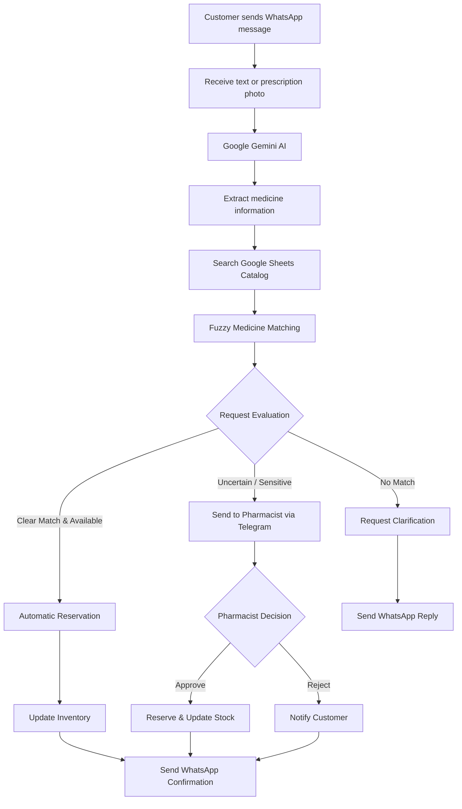

# 💊 Dawaa — AI-Powered Pharmacy Automation

<p align="center">
  <strong>Smarter Pharmacy Operations. Faster Medicine Reservations.</strong>
</p>

<p align="center">
  An AI-powered, bilingual WhatsApp pharmacy assistant built with n8n, Google Gemini, Google Sheets, and Telegram.
</p>

<p align="center">
  <a href="https://github.com/AhmedTarek1967/Dawaa">
    
  </a>
  
  
  
</p>

---

## 🌟 Overview

**Dawaa** is an intelligent pharmacy automation system that streamlines medicine requests and reservations through WhatsApp.

Customers can send a medicine name or a prescription photo. AI processes the request, identifies the requested medicines, checks their availability against a Google Sheets inventory, and determines the appropriate action.

Depending on the result, the system can automatically reserve available medicines, request pharmacist approval through Telegram, or notify customers when a medicine cannot be identified.

The goal is simple: **reduce manual work, improve inventory accuracy, and make pharmacy interactions faster and smarter.**

## ✨ Key Features

| Feature | Description |
|---|---|
| 🤖 AI Medicine Recognition | Uses Google Gemini to interpret medicine requests and prescription images. |
| 🌍 Bilingual Support | Handles Arabic and English medicine requests and customer replies. |
| 🔎 Smart Medicine Matching | Uses fuzzy matching to identify medicine names, including minor spelling mistakes. |
| 📦 Inventory Management | Checks medicine availability and updates stock automatically. |
| ⚡ Automatic Reservations | Reserves available medicines and generates reservation confirmations. |
| 🩺 Human-in-the-Loop | Sends uncertain or sensitive requests to pharmacists through Telegram. |
| ⏳ Reservation Expiration | Automatically expires reservations after two hours and restores inventory. |
| 📊 Low-Stock Monitoring | Generates daily low-stock reports for pharmacy management. |
| 🚨 Error Monitoring | Logs failed executions and sends notifications through Telegram and email. |

## 🔄 How It Works



## 🧩 Automation Workflows

Dawaa uses two main n8n workflow files, with additional scheduled automation and error-handling logic.

### 1. Main Workflow

Handles the complete medicine request lifecycle:

- Receives incoming WhatsApp messages.
- Identifies whether the customer sent text or a prescription image.
- Downloads prescription images when necessary.
- Uses Gemini to extract medicine information.
- Matches requested medicines against the inventory.
- Evaluates stock availability and matching confidence.
- Automatically processes eligible reservations.
- Routes uncertain requests to a pharmacist.
- Sends the appropriate customer notification.

### 2. Error Handling Workflow

Provides centralized monitoring and failure reporting:

- Captures failed workflow executions.
- Records error details in Google Sheets.
- Sends error notifications through Telegram and email.

### 3. Scheduled Automation

| Automation | Frequency | Action |
|---|---|---|
| Reservation Expiration | Every 15 minutes | Expires reservations and restores stock. |
| Low-Stock Monitoring | Daily at 22:00 | Generates and sends a medicine reorder report. |

## 🛠️ Technology Stack

| Technology | Purpose |
|---|---|
| [n8n](https://n8n.io/) | Workflow automation and orchestration |
| [Google Gemini](https://ai.google.dev/) | AI-powered medicine and prescription recognition |
| [WhatsApp Business API](https://developers.facebook.com/docs/whatsapp/) | Customer communication |
| [Google Sheets](https://sheets.google.com/) | Medicine catalog, reservations, and error records |
| [Telegram Bot API](https://core.telegram.org/bots/api) | Pharmacist approval and notifications |
| [Gmail](https://mail.google.com/) | Automated email notifications |
| JavaScript | Data transformation, validation, and fuzzy matching |

## 📁 Project Structure

```text
Dawaa/
│
├── workflows-public/
│   ├── Dawaa_Main_Workflow.json
│   └── Dawaa_Error_Handling.json
│
├── sample-data/
│   ├── Catalog.csv
│   ├── Reservations.csv
│   └── Errors.csv
│
├── index.html
└── README.md
```

## 🚀 Getting Started

Follow these steps to deploy Dawaa using your own accounts and n8n instance.

### Prerequisites

- An n8n instance (self-hosted or cloud).
- Google Gemini API key.
- Google account with Google Sheets access.
- WhatsApp Business API credentials.
- Telegram Bot and Chat ID.
- Gmail account for email notifications.

### 1. Clone the Repository

```bash
git clone https://github.com/AhmedTarek1967/Dawaa.git

cd Dawaa
```

### 2. Prepare Google Sheets

Create a Google Spreadsheet with the following three tabs:

| Sheet | Purpose |
|---|---|
| Catalog | Medicine information, prices, SKU, and available stock. |
| Reservations | Customer reservations and reservation status. |
| Errors | Workflow execution errors and debugging information. |

Import the corresponding CSV files from the `sample-data/` directory.

### 3. Configure Credentials

Prepare your credentials in n8n:

- WhatsApp Business API.
- Google Gemini API.
- Google Sheets OAuth2.
- Telegram Bot API.
- Gmail OAuth2.

### 4. Configure Workflow Variables

Open the downloaded workflow JSON files and replace the placeholder values with your actual configuration.

```text
YOUR_GOOGLE_SHEET_ID
YOUR_TELEGRAM_CHAT_ID
YOUR_WHATSAPP_PHONE_NUMBER_ID
your-email@example.com
```

Make sure to configure the corresponding n8n credentials and select the correct Google Sheets documents and tabs.

### 5. Import Workflows into n8n

1. Open your n8n dashboard.
2. Select **Import from File**.
3. Import `Dawaa_Main_Workflow.json`.
4. Import `Dawaa_Error_Handling.json`.
5. Verify node configurations and credentials.
6. Configure the WhatsApp webhook using your public HTTPS endpoint.

### 6. Activate and Test

Activate the workflows and test the system by sending a medicine request to your WhatsApp Business number.

Test different scenarios:

- A valid medicine request.
- A medicine request containing spelling mistakes.
- Multiple medicine requests.
- An unavailable medicine.
- A prescription image.
- A request requiring pharmacist approval.

> **Important:** The repository includes a browser-based interactive demonstration using sample data. The live n8n integration requires your own API credentials, configured workflows, and connected services.

## 📥 Downloads

You can import the automation workflows directly into your n8n instance.

| Resource | File |
|---|---|
| Main Automation Workflow | [Dawaa_Main_Workflow.json](workflows-public/Dawaa_Main_Workflow.json) |
| Error Handling Workflow | [Dawaa_Error_Handling.json](workflows-public/Dawaa_Error_Handling.json) |
| Medicine Catalog | [Catalog.csv](sample-data/Catalog.csv) |
| Reservations Data | [Reservations.csv](sample-data/Reservations.csv) |
| Error Records | [Errors.csv](sample-data/Errors.csv) |

## 🔐 Security & Configuration

- Never commit API keys, access tokens, or OAuth credentials.
- Use your own credentials when importing workflows.
- Keep sensitive customer information out of public repositories.
- Configure appropriate access permissions for Google Sheets.
- Use HTTPS for externally accessible webhooks.
- Review pharmacist approval rules before using the system in a real pharmacy.

**Note:** Dawaa is an automation project and demonstration, not a medical diagnosis or prescription system. Medicine dispensing decisions and prescription validation must remain under qualified pharmacist supervision.

## 🗺️ Future Improvements

Potential areas for further development:

- [ ] Persistent customer profiles and order history.
- [ ] Advanced medicine search and alternative recommendations.
- [ ] Reservation tracking dashboard.
- [ ] Multi-branch pharmacy inventory support.
- [ ] Real-time analytics and sales reporting.
- [ ] Improved prescription extraction and validation.
- [ ] Automated reservation reminders.

## 👨‍💻 Author

**Ahmed Tarek**

Junior Backend Developer | AI Automation Enthusiast

- GitHub: [@AhmedTarek1967](https://github.com/AhmedTarek1967)
- Project: [Dawaa](https://github.com/AhmedTarek1967/Dawaa)

---

<p align="center">
  <strong>Built with ❤️ using n8n, AI, and automation.</strong>
  <br>
  <sub>Making pharmacy operations smarter, one workflow at a time.</sub>
</p>
